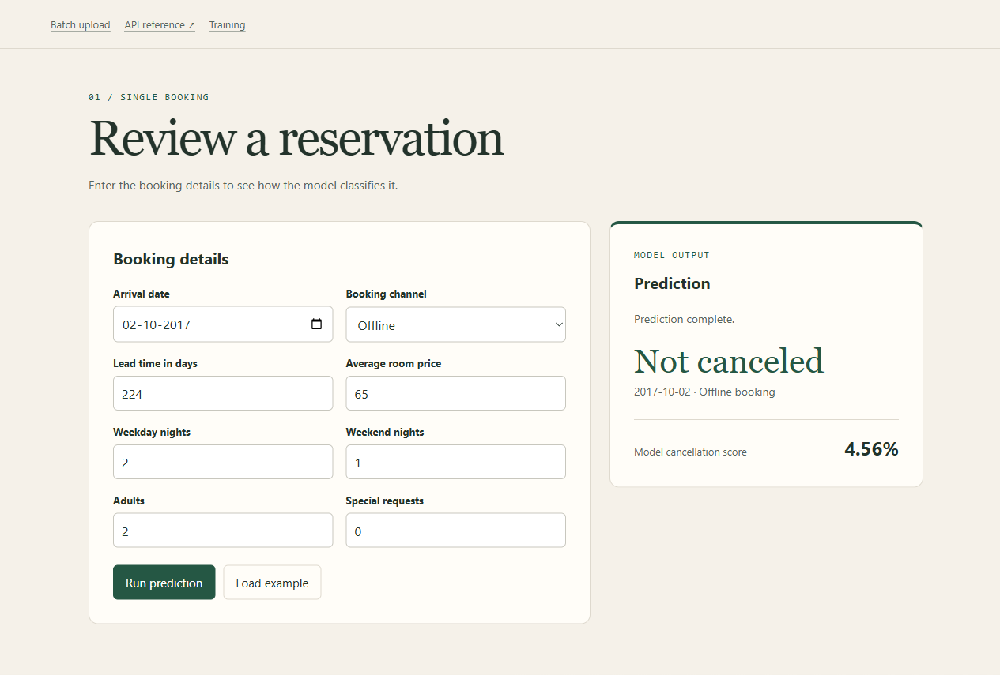
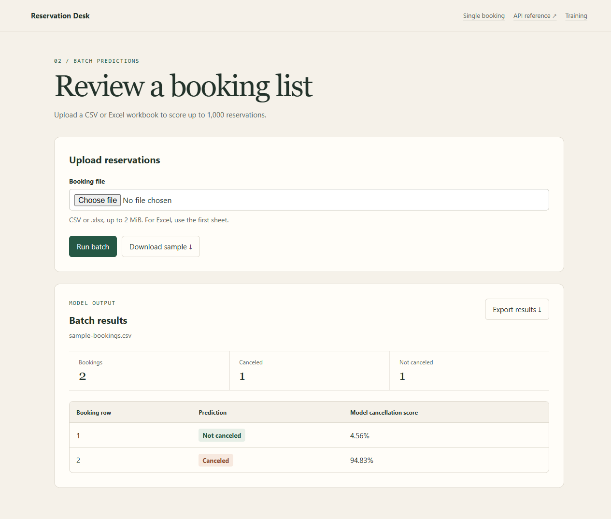
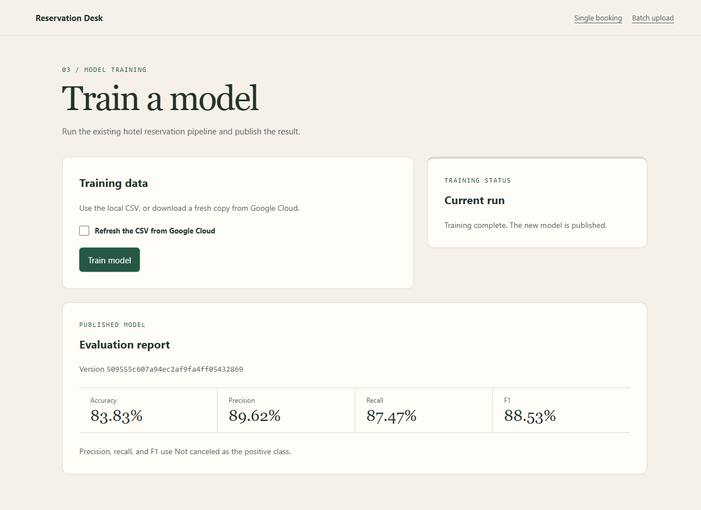

# Hotel Reservation

Reservation Desk is a local app for predicting whether a hotel booking will be canceled. Enter one booking in the browser, upload a CSV or Excel workbook, or send a list of bookings to the JSON API. The Training page runs the existing LightGBM pipeline and publishes the finished model so the next prediction can use it.

## Reservation Desk

**Single booking.** Use the date picker and booking channel dropdown, then review the predicted outcome and cancellation score. **Load example** fills in a booking you can run right away.



**Batch upload.** Download the sample CSV or upload your own. The results show each booking in input order, with counts by outcome and a CSV export.



**Training.** Fit a model from the local dataset or refresh it from Google Cloud Storage first. The page tracks the run and displays the published version and its MLflow metrics.



## Run locally

Run the commands from the repository root in your Python environment. The project was exercised on Python 3.10 with BentoML 1.4.40, LightGBM 4.7.0, and scikit-learn 1.7.2.

```powershell
python -m pip install -r requirements.txt "bentoml==1.4.40" "lightgbm==4.7.0" "scikit-learn==1.7.2" fastapi jinja2 python-multipart
```

### Prepare a model

On startup, the app loads the version selected by `reservation_app/model_versions/current.json`. Before a version has been published, it uses `artifacts/models/lgbm_model.pkl` and `config/mapping.json` together.

Generated models, mappings, and the raw dataset are ignored by Git. On a fresh checkout, put the full training CSV at `artifacts/raw/raw.csv` and publish a model:

```powershell
python -m reservation_app.training
```

If you use the Google Cloud Storage source, configure the bucket and object in [config.yaml](config/config.yaml), then run:

```powershell
python -m reservation_app.training --refresh-data
```

The refresh uses [Google Application Default Credentials](https://cloud.google.com/docs/authentication/application-default-credentials). If you use `GOOGLE_APPLICATION_CREDENTIALS`, point it at an absolute path. The training subprocess runs from its own working directory.

### Start Reservation Desk

```powershell
bentoml serve reservation_app.service:HotelPredictionService --host 127.0.0.1 --port 3000
```

Open [Reservation Desk](http://127.0.0.1:3000/desk/) and try **Load example**. The [BentoML API reference](http://127.0.0.1:3000/) is on the same server.

| Page | Path |
| --- | --- |
| Single booking | `/desk/` |
| CSV and Excel batch | `/desk/batch` |
| Train and publish | `/desk/training` |

The Training page uses the root-level `artifacts/raw/raw.csv` when the refresh box is unchecked. A GCS refresh downloads into that run's workspace, so it does not populate the root-level snapshot.

## Prediction inputs

The model uses ten fields: lead time, number of special requests, average room price, booking channel, arrival year, month and day, weekday nights, weekend nights, and number of adults. The form turns one arrival date into three fields. The predictor looks up the channel in the mapping saved with the model and arranges the inputs in the fitted column order.

For uploads, start with [the sample CSV](http://127.0.0.1:3000/desk/batch/sample.csv). Use a UTF-8 CSV or the first sheet of an `.xlsx` workbook, with headers in the first row. Each file can contain up to 1,000 bookings and be up to 2 MiB. Keep the required column names and the channel labels from the sample or form. The parser ignores extra columns, including `Booking_ID` and `booking_status`. If any row fails validation, the page identifies the first invalid booking and field before scoring the batch.

### JSON API example

`POST /predict` accepts a `bookings` array containing 1 to 1,000 named records. A single prediction is a one-item array.

```powershell
$body = @'
{
  "bookings": [
    {
      "lead_time": 224,
      "no_of_special_requests": 0,
      "avg_price_per_room": 65.0,
      "market_segment_type": "Offline",
      "arrival_year": 2017,
      "arrival_month": 10,
      "arrival_date": 2,
      "no_of_week_nights": 2,
      "no_of_weekend_nights": 1,
      "no_of_adults": 2
    }
  ]
}
'@

Invoke-RestMethod -Uri 'http://127.0.0.1:3000/predict' `
  -Method Post -ContentType 'application/json' -Body $body |
  ConvertTo-Json -Depth 4
```

```json
{
  "count": 1,
  "results": [
    {
      "row": 1,
      "status": "Not_Canceled",
      "cancellation_score": 0.0456
    }
  ]
}
```

The response shown comes from the saved model used in the screenshots. The UI displays the decimal score as a percentage. This is a model score rather than a calibrated estimate of a hotel's real-world cancellation rate.

## Training and serving

The original pipeline lives under [pipeline/](pipeline/) and [src/](src/). It reads the hotel dataset, encodes categories, removes duplicates, and creates a stratified train/test split. The training partition is balanced with SMOTENC and reduced to ten features. The trainer uses five-fold randomized search for LightGBM and logs holdout metrics to MLflow.

The app wraps that pipeline in a separate working directory for each run. Training writes its own data, logs, and MLflow database there. Before publication, the wrapper reloads the candidate, checks the selected fields and preprocessing against the desk's input contract, and scores a sample booking. Only then does it update `current.json`. While training runs, single and batch predictions keep using the current model. On the first request after publication, the store loads the new model and mapping together.

| Entry point | Role |
| --- | --- |
| [`pipeline/training_pipeline.py`](pipeline/training_pipeline.py) | Original Google Cloud ingestion, preprocessing, and training entry point |
| [`reservation_app/training.py`](reservation_app/training.py) | Runs the existing pipeline in a separate workspace and publishes validated artifacts |
| [`reservation_app/training_jobs.py`](reservation_app/training_jobs.py) | Starts a background training process and reports its status |
| [`reservation_app/model_store.py`](reservation_app/model_store.py) | Loads the active version and caches the fitted model |
| [`reservation_app/predictor.py`](reservation_app/predictor.py) and [`batch.py`](reservation_app/batch.py) | Validate booking records, read spreadsheet uploads, and score rows |
| [`reservation_app/service.py`](reservation_app/service.py) and [`web.py`](reservation_app/web.py) | BentoML prediction endpoint and mounted FastAPI pages |

### Evaluation snapshot

The local run shown above used the existing training pipeline and its holdout split.

| Accuracy | Precision | Recall | F1 |
| ---: | ---: | ---: | ---: |
| 83.83% | 89.62% | 87.47% | 88.53% |

Precision, recall, and F1 treat `Not_Canceled` as the positive class. These values describe one split of the project's dataset.

### Local operating limits

The app uses one BentoML worker and tracks the latest UI training job in that worker's memory. Refreshing the page reconnects to the job. Restarting the server resets the displayed job state. Published model versions and metrics stay on disk under `reservation_app/model_versions/`. The included launch command binds to localhost. A shared deployment needs authentication for training and persistent job tracking.

File uploads support CSV and `.xlsx`. API clients can send DataFrame rows as named JSON records. PDF files and positional arrays are not supported.
